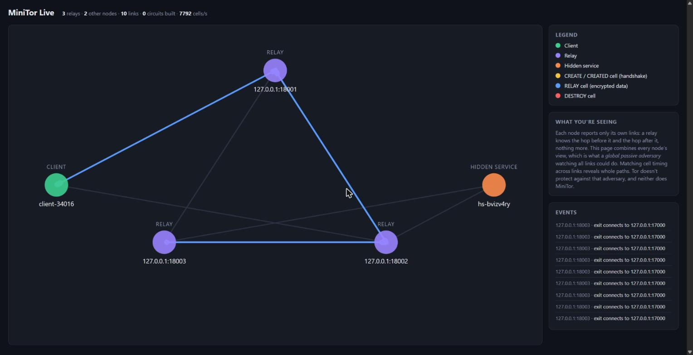

# MiniTor

[](https://github.com/nati2126/MiniTor/actions/workflows/tests.yml)
[](https://codecov.io/gh/nati2126/MiniTor)
[](https://www.python.org/)

A small onion routing network in Python, modeled on Tor. I built it to learn how Tor works, so it follows the real design where it can: circuits built hop by hop, fixed-size cells, a signed directory, exit policies, a SOCKS proxy and `.onion` hidden services.

It is for learning only. Don't use it to hide anything real.



## Quick start

```bash
docker compose up -d --build
```

This starts a directory server, 4 relays, an echo server, a hidden service, a SOCKS proxy and the live view.

- Live view: http://127.0.0.1:8080/
- Go through the network: `curl --socks5-hostname 127.0.0.1:9050 http://echo-server:7000/`
- Hidden service address: `docker compose exec hidden-service cat /keys/hs-hostname`
- Visit it: `curl --socks5-hostname 127.0.0.1:9050 http://<address>.onion/`
- Interactive client: `docker compose run --rm client`
- Stop: `docker compose down`

The echo server tells you which IP connected to it. It's always the exit relay, never you.

## Running without Docker

```bash
python -m venv .venv && source .venv/bin/activate   # Windows: .venv\Scripts\activate
pip install -e ".[dev]"
```

Start each of these in its own terminal:

```bash
minitor-directory --write-pubkey dir.pub
minitor-echo --port 7000
minitor-relay --port 8001 --dir-key @dir.pub --allow-exit 127.0.0.1:7000
minitor-relay --port 8002 --dir-key @dir.pub --allow-exit 127.0.0.1:7000
minitor-relay --port 8003 --dir-key @dir.pub --allow-exit 127.0.0.1:7000
minitor-hs --dir-key @dir.pub --port 80:127.0.0.1:7000      # optional hidden service
minitor-viz                                                  # optional, add --viz 127.0.0.1:9999 to the others
```

Then:

```bash
minitor-client --dir-key @dir.pub -m "hello"                          # message to an exit relay
minitor-client --dir-key @dir.pub --dest 127.0.0.1:7000 -m "who am I"  # through an exit to a server
minitor-client --dir-key @dir.pub --socks-port 9050                    # SOCKS5 proxy
```

Every command has `--help`.

## How it works

**Directory.** Each relay has an Ed25519 identity key and an X25519 onion key. It publishes a signed descriptor (address, keys, exit policy) to the directory and keeps refreshing it. The directory signs the list of live relays. Clients and relays check that signature against a key they pin with `--dir-key`.

**Circuits.** The client picks 3 random relays and builds the circuit one hop at a time. It does an ntor handshake with the first relay, then asks that relay to extend to the second, and so on. Each hop ends up with its own keys, and the handshake keys are thrown away afterwards, so recorded traffic can't be decrypted later.

**Cells.** Everything on the wire is a 512-byte cell. The client encrypts each message once per hop (AES-CTR). Each relay removes one layer and checks a MAC to see if the message is meant for it. If not, it passes the cell on. If a relay changes a cell, the MAC check fails and the circuit is closed.

**Streams.** A circuit stays open and carries many TCP streams to different destinations. Data is split across cells, and SENDME messages limit how much can be in flight, like in Tor.

**Exit policies.** An exit only connects where its `--allow-exit` rules allow. Wildcard rules like `*:80` never reach private addresses such as 127.0.0.1.

**Hidden services.** A service keeps circuits open to a few introduction points and publishes their list, signed with its key. The `.onion` address is that key. A client picks a rendezvous relay and sends the service an encrypted introduction. The service then builds its own circuit to the rendezvous relay. Neither side learns the other's IP.

**Live view.** With `--viz`, each node reports the links it has open and the cells it sends. The page combines all of them. Watching every link at once like this is exactly the attack Tor can't stop.

## Limitations

- An attacker who watches traffic at both ends (or everywhere) can match timing. Tor has the same problem.
- Links between nodes are plain TCP, not TLS.
- There is one directory server, and anyone can register relays.
- The client picks a new random entry relay every time. Tor uses fixed entry guards.
- An exit relay can read traffic that isn't encrypted end to end. Use HTTPS.

## Tests

```bash
pytest
ruff check . && mypy
```

The tests start real relays, clients and hidden services on local ports. CI runs them on Linux, Windows and macOS, and also starts the Docker setup and checks it.

## License

MIT
